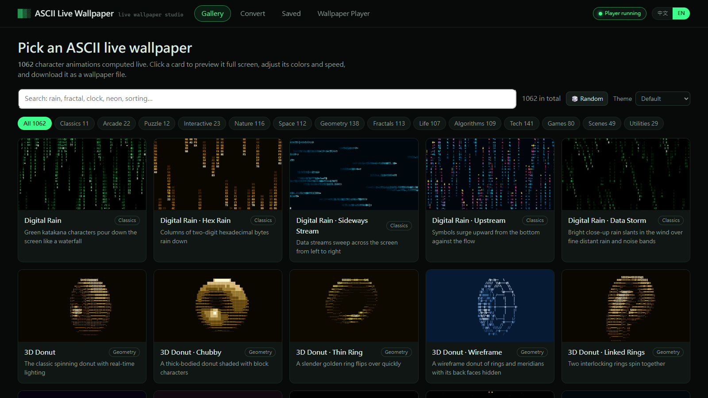
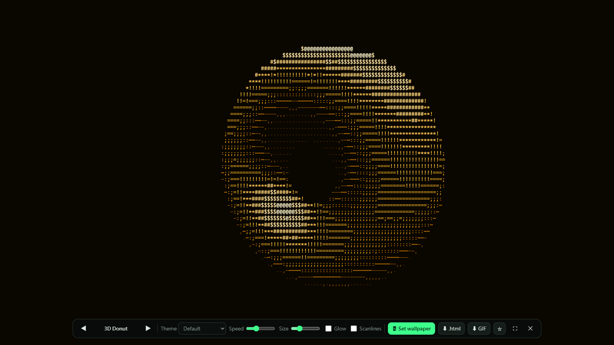

# ASCII Live Wallpaper (ASCII 動態桌布)

[中文說明](README.md) · The interface switches between 中文 and English (the "中文 | EN" toggle at the top right, or "語言 / Language" in the tray menu).

Turn your Windows desktop into **live ASCII character animations**: 1062 procedurally generated wallpapers, mini-games you play with the mouse right on the desktop, a ray-traced 3D Newton's cradle with 3D spatial sound, and a converter that turns your own images, GIFs and videos into ASCII wallpapers. It comes with its own wallpaper player — no Wallpaper Engine or Lively needed.



## Features

| Part | What it does |
|---|---|
| Gallery | 1062 ASCII animations in 14 categories (Classics, Arcade, Puzzle, Interactive, Nature, Space, Geometry, Fractals, Life, Algorithms, Tech, Games, Scenes, Utilities); search, change the color theme, preview full screen, then set it as your wallpaper in one click |
| Interactive wallpapers | 62 playable wallpapers: Whack-a-Mole, Brick Smasher, Paddle Duel, Fruit Slicer, Bubble Pop, Minefield, Four in a Row, Reversi, Gomoku, Sand Art, Click Fireworks, Life Canvas… Play them with the mouse while the cursor is over the desktop; when nobody plays, the computer plays a demo |
| 3D Newton's cradle | Per-character ray tracing: chrome balls with reflections, shadows and perspective; real physics (pull out k balls and k balls fly out the other side); grab a ball with the mouse and let go; every clack is placed in 3D space (best with headphones) |
| Convert | Image, GIF and video to ASCII animation, with character sets, color themes and effects; export as GIF |
| Saved / Playlist | Keep your converted wallpapers; rotate several wallpapers |
| Wallpaper player | One wallpaper per monitor; pauses automatically when covered by windows, in full screen, when the PC is locked or the display is off (saves power, stays silent); sound on/off, language, start with Windows |

| 3D Newton's cradle | Full-screen preview |
|---|---|
|  |  |

## Run it

Requires Windows 10 / 11 (uses the built-in Microsoft Edge and .NET Framework 4.8 — nothing to install).

1. Download the zip from [Releases](../../releases) and extract both files into the same folder (`ASCII桌布播放器.exe` and `ASCII動態桌布.html` must stay together with these exact names).
2. Run `ASCII桌布播放器.exe` (the wallpaper player). It lives in the system tray and opens the manager the first time.
3. In the gallery, click a card to preview it, press "Set wallpaper" and choose the monitor.

The tray menu opens the manager, pauses, toggles sound, switches the language, creates desktop shortcuts and sets up "Start with Windows"; "Exit" restores your original wallpaper.

### Playing the interactive wallpapers

- Move the mouse over the desktop (any part not covered by a window): move, click, hold and drag, scroll.
- Left button only. The keyboard is never used (so you can't accidentally rename desktop icons), and right-click still opens the normal desktop menu.
- After about 6 seconds without input, the computer takes over again.

## Build it yourself

The player uses only C# 5, so Windows' built-in compiler is enough. Double-click:

```bat
player-src\build.bat
```

It produces `ASCII桌布播放器.exe` in the project folder.

Animations live in `src-anims\*.js` (one module per file) and are built into the HTML with [Node.js](https://nodejs.org/):

```bash
node tools/build.js
```

| File | Contents |
|---|---|
| `ASCII動態桌布.html` | Manager UI, wallpaper page, renderer and sound engine (one file; animations are inserted by `tools/build.js`) |
| `src-anims/*.js` | Animation modules; `zz-i18n-en.js` is the English name table (generated by `tools/i18n-build.js`) |
| `player-src/Player.cs` | The wallpaper player: embeds Edge windows into the desktop, auto-pause, mouse forwarding, local HTTP server, tray icon |
| `tools/anim-harness.js` | Tests every animation in Node (format, errors, speed, blank frames, simulated mouse play): `node tools/anim-harness.js --all`, add `--lang en` for English |
| `tools/build.js` | Builds `src-anims` into the HTML (`--skip <name part>` leaves modules out) |
| `tools/i18n-build.js` | Merges the English name table |
| `tools/prune.js` | Deletes animations or variants listed in a file |

## Notes

- Settings, saved items, logs and the player's own Edge profiles are stored in `%LOCALAPPDATA%\ASCIIWallpaper`.
- The player serves the manager only on `http://127.0.0.1:17321`; nothing is sent to the internet.
- Each monitor's wallpaper is a Microsoft Edge window (separate profile, no extensions) placed behind the desktop icons.
- Sound plays only while the desktop is visible; when the same sound wallpaper is on several monitors, only one of them makes sound.
