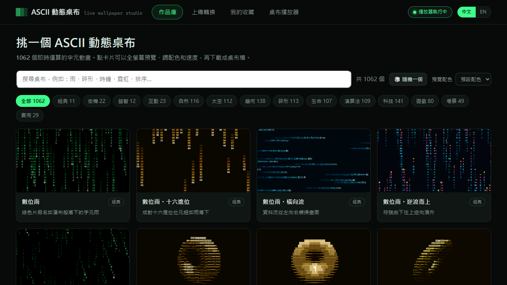
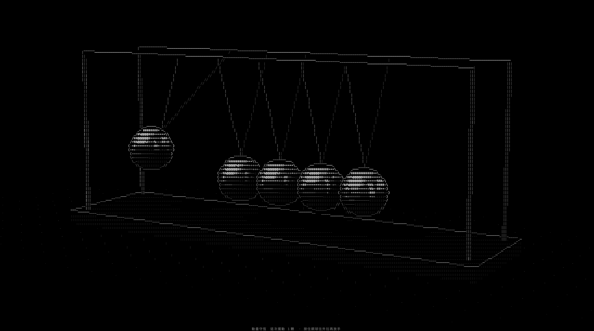
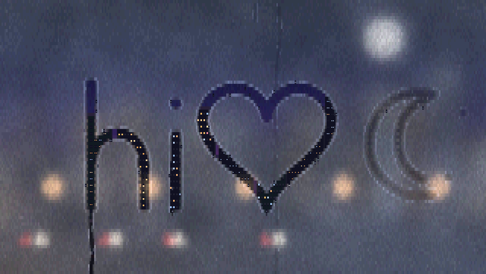
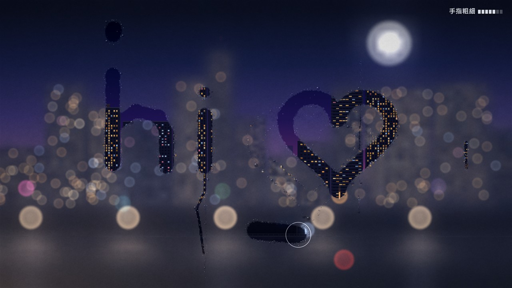

# ASCII 動態桌布 (ASCII Live Wallpaper)

[English README](README.en.md) · 介面可以切換中文 / English（右上角的「中文 | EN」，或系統匣選單的「語言 / Language」）。

把 Windows 桌面換成**即時運算的 ASCII 字元動畫**：1068 個程式產生的動畫桌布、可以直接在桌面上用滑鼠玩的互動小遊戲、光線追蹤的 3D 牛頓擺（含 3D 立體音效）、可以在上面畫畫的起霧玻璃（另有 GPU 繪製的寫實影像版），也能把自己的圖片、GIF、影片轉成 ASCII 桌布。附一個自己寫的桌布播放器，不需要 Wallpaper Engine 或 Lively。



## 功能

| 分頁 / 部分 | 內容 |
|---|---|
| 作品庫 | 1068 個動畫，分成經典、街機、益智、互動、寫實、自然、太空、幾何、碎形、生命、演算法、科技、遊戲、場景、實用；可以搜尋、換配色、全螢幕預覽，再一鍵設為桌布 |
| 互動桌布 | 68 個可以玩的桌布：起霧的玻璃（用滑鼠在霧上畫畫）、打地鼠、打磚塊、乒乓對打、切水果、戳泡泡、踩地雷、四子棋、黑白棋、五子棋、沙畫、點擊煙火、生命畫布…… 游標在桌面上時直接用滑鼠玩；沒人玩的時候電腦會自己示範 |
| 寫實影像桌布 | 不是字元、用 GPU（WebGL）即時繪製的桌布：「起霧的玻璃・影像」有真正的模糊和光暈、會折射的水珠、沿玻璃流下的水痕，窗外夜晚城市／雪地清晨／雨夜街角三個場景，玩法和 ASCII 版一樣 |
| 3D 牛頓擺 | 逐格光線追蹤的鍍鉻鋼珠、反射、陰影和透視；真的物理模擬（拉起幾顆、另一邊就飛出幾顆），可以用滑鼠把球拉起來放開、按住右鍵拖曳轉動視角、滾輪縮放；碰撞聲依撞擊位置做 3D 立體音效（戴耳機最明顯） |
| 上傳轉換 | 圖片、GIF、影片轉成 ASCII 動畫，可調字元、配色、效果，匯出 GIF |
| 我的收藏 / 輪播 | 收藏自己轉換的桌布；多個桌布輪流播放 |
| 桌布播放器 | 每個螢幕各放一張桌布；被視窗蓋住、全螢幕、鎖定電腦或螢幕關閉時自動暫停（省電、不出聲）；開關音效、切換語言、開機自動啟動 |

| 3D 牛頓擺 | 起霧的玻璃（ASCII） |
|---|---|
|  |  |



## 執行

需要 Windows 10 / 11（內建的 Microsoft Edge 和 .NET Framework 4.8，不用另外安裝）。

1. 到 [Releases](../../releases) 下載 zip，解壓縮到同一個資料夾（`ASCII桌布播放器.exe` 和 `ASCII動態桌布.html` 要放在一起，檔名不要改）。
2. 執行 `ASCII桌布播放器.exe`。它會在系統匣（右下角）常駐，第一次會自動打開管理介面。
3. 在作品庫點一張卡片預覽，按「🖥 設為桌布」，選擇要放在哪個螢幕。

系統匣選單可以開管理介面、暫停、開關音效、切換語言、建立桌面捷徑、設定開機自動啟動；「結束」會恢復原本的桌布。

### 互動桌布怎麼玩

- 把滑鼠移到桌面上（沒有被視窗蓋住的地方）就能玩：移動、點擊、按住拖曳、滾輪。
- 主要用滑鼠左鍵：不會用到鍵盤（避免改到桌面圖示的名稱）。只有 3D 牛頓擺這類可以轉動視角的桌布會用「按住右鍵拖曳」，右鍵只點一下時仍然是桌面原本的選單。
- 約 6 秒沒有操作，電腦會接手示範。

## 自己編譯

播放器只用 C# 5 語法，用 Windows 內建的編譯器就能建置。雙擊：

```bat
player-src\build.bat
```

會在專案資料夾產生 `ASCII桌布播放器.exe`。

動畫放在 `src-anims\*.js`（每個檔案一個模組），用 [Node.js](https://nodejs.org/) 組進 HTML：

```bash
node tools/build.js
```

| 檔案 | 內容 |
|---|---|
| `ASCII動態桌布.html` | 管理介面、桌布頁面、繪圖引擎、音效引擎（全部在一個檔案；動畫由 `tools/build.js` 組進去） |
| `src-anims/*.js` | 動畫模組；`zz-i18n-en.js` 是英文名稱表（由 `tools/i18n-build.js` 產生） |
| `player-src/Player.cs` | 桌布播放器：把 Edge 視窗嵌進桌面、自動暫停、滑鼠轉送、本機 HTTP 服務、系統匣 |
| `tools/pixel-harness.js` | 在無頭 Edge 裡測試寫實影像桌布（WebGL）：畫面截圖、模擬滑鼠、每格的 CPU / GPU 時間、WebGL 錯誤 |
| `tools/anim-harness.js` | 在 Node 裡測試每一個動畫（格式、錯誤、效能、是否空白、互動模擬）：`node tools/anim-harness.js --all`，加 `--lang en` 測英文 |
| `tools/build.js` | 把 `src-anims` 組進 HTML（`--skip <檔名片段>` 可略過模組） |
| `tools/i18n-build.js` | 合併英文名稱表 |
| `tools/prune.js` | 依清單刪除動畫或變化款 |

## 注意事項

- 設定、收藏、紀錄和播放器專用的 Edge 設定檔存在 `%LOCALAPPDATA%\ASCIIWallpaper`。
- 播放器只在本機 `http://127.0.0.1:17321` 提供管理介面，不會連到網路。
- 每個螢幕的桌布是一個 Microsoft Edge 視窗（獨立的設定檔、不載入擴充功能），嵌在桌面圖示後面。
- 音效只在看得到桌面的時候播放；同一張有聲桌布放在多個螢幕時只有一個會出聲。
